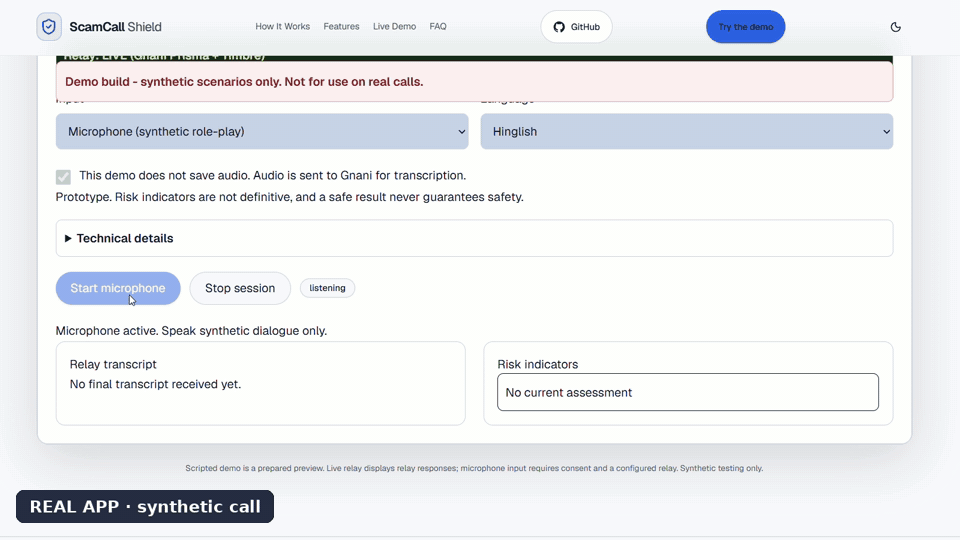
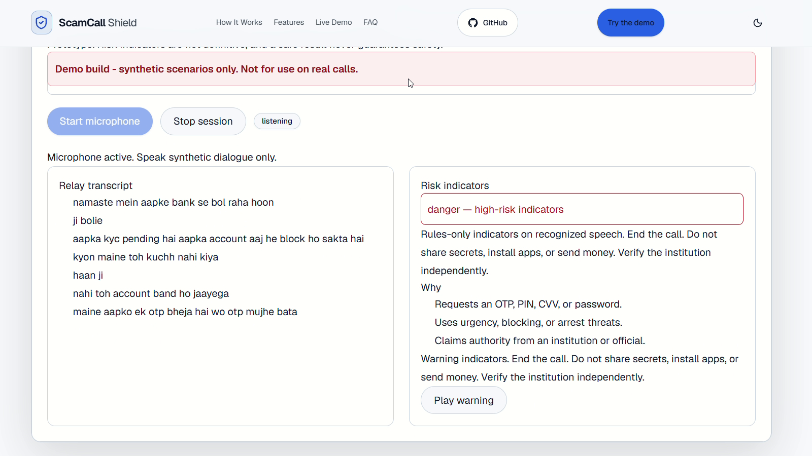
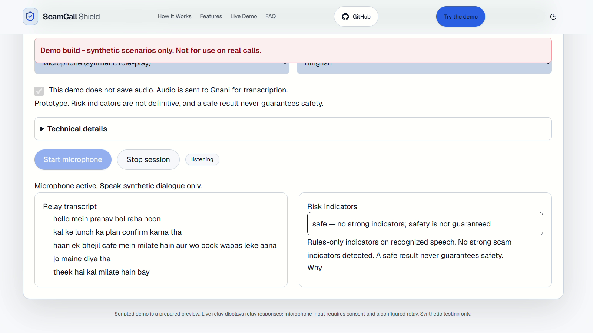
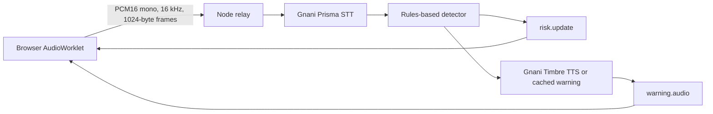

# ScamCall Shield

Pause before you share.

Scam callers pressure people to share OTPs or “verify” KYC before they can pause.
In a synthetic call demo, ScamCall Shield shows that pressure pattern as it happens,
in plain words, with a spoken warning.

One-page pitch: [PITCH.md](PITCH.md)



Real app, synthetic call. Mic on, live transcription, risk level and explanation.

<!-- Watch the demo: [Watch the demo video]([DEMO VIDEO LINK]) -->

[CI checks](https://github.com/ItzPranav61/scam-call-shield/actions/workflows/ci.yml)

## What it is

ScamCall Shield is a research prototype for synthetic call demonstrations.
It listens through the laptop microphone to a call played on speaker and transcribes
it live with Gnani Prisma STT. A rules-based detector flags patterns as **safe**,
**caution** or **danger** and explains why. It then plays a spoken warning produced
by Gnani Timbre TTS, reusing cached warning audio where available.

## Demo

[Open the hosted scripted preview](https://scamcall-shield-website.vercel.app).
The hosted site shows prepared scripts, not live analysis. **Live mode runs on a
local relay**; follow the setup below to try microphone input.

### Screenshots



Real app, synthetic call. DANGER state with the explanation visible.



Real app, synthetic call. SAFE state on a benign/genuine-call script.


## How it works

The relay owns the STT connection, detector and warning cache. The diagram shows
the processing flow; browser messages always pass through the relay.



[Message contract v1.2](docs/contract.md):

- `session.start` requires consent, language and audio configuration. Its payload
  `version` remains `1`; `session.ready` confirms readiness before audio starts.
- Microphone audio uses binary PCM16 frames, not JSON or WAV uploads.
- `transcript.final` appends a final segment; `risk.update` carries the level,
  explanation and evidence references. Risk only escalates within a session.
- `warning.audio` carries one complete base64 WAV per warning code per session,
  after the matching risk update. Playback requires the user's Start gesture.
- `session.end` releases capture and connections. Errors or disconnection stop
  capture and clear the assessment.

## What it flags

The implemented [rules](packages/detector/src/signals.ts) and
[tests](packages/detector/test/detector.test.ts) cover:

- Requests for OTPs, PINs, CVVs or passwords.
- KYC-pending, account/SIM-block and immediate-action pressure.
- Authority impersonation combined with arrest or case threats (covered by the rules and tests; coverage on live speech varies).
- Money transfers, UPI/refund fees and conditional payment pressure.
- Remote-access, app/APK installation and link-click requests.
- Secrecy or isolation pressure, such as hiding the call from family or staying on the line.

Synthetic test input: `Apna OTP bataiye.` The following is the actual `risk.update`
captured from a local mock relay running the detector on that single final segment.
It includes the generated session ID and evidence reference, unchanged:

```json
{
  "type": "risk.update",
  "sessionId": "f18d59e4-89fb-4134-8e11-1ff13f7b64d3",
  "assessment": {
    "level": "danger",
    "indicators": [
      {
        "code": "sensitive",
        "explanation": "Requests an OTP, PIN, CVV, or password.",
        "segmentIds": [
          "example-segment"
        ]
      }
    ],
    "summary": "Rules-only indicators on synthetic mock transcripts. End the call. Do not share secrets, install apps, or send money. Verify the institution independently."
  }
}
```

Rules are transparent and explainable, which is also why they can miss or over-flag;
see [Limits](#limits).

## Run locally

**Prerequisites:** Node.js **24.x** ([declared engine](apps/web/package.json)),
npm and a laptop microphone. The launcher needs Windows PowerShell.

Clone and install (PowerShell or bash):

```sh
git clone https://github.com/ItzPranav61/scam-call-shield.git
cd scam-call-shield
npm ci
```

### Mock mode — no key or credits needed

From the repository root in a fresh terminal, start the relay. Its default is mock:

```sh
npm run dev:relay
```

In a second terminal at the repository root:

Windows PowerShell:

```powershell
$env:NEXT_PUBLIC_RELAY_URL = 'ws://localhost:8787/ws'
npm run dev:web -- --port 3000
```

macOS/Linux (bash):

```bash
NEXT_PUBLIC_RELAY_URL=ws://localhost:8787/ws npm run dev:web -- --port 3000
```

Open [localhost:3000](http://localhost:3000/). Choose **Live relay**, then
**Scenario playback** and `kyc-otp`. Tick consent and Start. **MOCK** uses scripted
transcripts and warning tones, not speech transcription. The separate
**Scripted preview - not live** tab needs no relay or microphone.

Check the relay in another terminal.

Windows PowerShell:

```powershell
Invoke-RestMethod -Uri 'http://localhost:8787/health'
```

macOS/Linux (bash):

```bash
curl http://localhost:8787/health
```

Expect `ok: true`, `mode: mock`. Relay: **8787**, WebSocket: `/ws`; web: **3000**.

### Live mode — local relay and Gnani credits

Stop the mock servers with Ctrl+C first. Create a `.env` file **at the repository
root**, using [.env.example](.env.example) as the template. Set `GNANI_API_KEY`
there using your own key. Never commit that file or put a key in the browser or
web deployment settings. The relay loads it itself; missing credentials fail
startup instead of falling back to mock.

Check Gnani dashboard credits before and after a live session. Start the relay (PowerShell or bash):

```sh
npm run dev:relay:live
```

Start the web as above. Confirm `/health` reports `mode: live` and the badge is
green **LIVE**. Select **Microphone**, tick consent, Start and allow microphone
access. Play synthetic dialogue on a nearby speaker. **Scenario playback is mock
only**; the live relay rejects scenario requests.

### Windows only — start/stop launchers

This launcher replaces both manual server commands, sets their local connection
options and opens the recording view:

```powershell
.\scripts\start-demo.ps1
```

Both ports must be free. The launcher reports the owning process ID if a port is
occupied. Open the clean capture view directly at
[?record=1](http://localhost:3000/?record=1#interactive-demo-title).
See the [recording guide](docs/demo-recording.md) for capture setup.

Stop the Windows demo with:

```powershell
.\scripts\stop-demo.ps1
```

The stop script stops listeners on ports 8787 and 3000. Server windows may remain
open; close them yourself. Only run it when those ports belong to your demo.

## Repo layout

- `apps/web` — Next.js website, scripted preview and consented microphone client.
- `apps/relay` — Node WebSocket relay, Gnani connections and warning cache.
- `packages/detector` — Pure rules-based analysis and session risk state.
- `packages/protocol` — Shared browser/relay message types.

## Safety and privacy

- This app does not save audio. Live audio is sent to Gnani for transcription.
- The Gnani key lives only on the relay. `NEXT_PUBLIC_RELAY_URL` is a public URL,
  never a credential.
- Microphone access requires explicit consent and a user Start action.
- The default session limit is **300 seconds**. Stop ends microphone capture.
- Use synthetic data only. Do not speak real OTPs, personal or financial details.

## Limits

This prototype has been tested with synthetic calls and speaker playback.
**Not for use on real calls.** Rules can miss scam patterns or over-flag harmless
speech. A safe result never guarantees safety. The speaker-to-microphone path is
noisy, so transcription and warning behaviour can vary. Browser microphone access
does not intercept cellular calls.

## Tests

```sh
npm test
npm run typecheck
npm run lint
npm run build
```

Run these from the repository root after installing dependencies; no key is needed.

## License

[MIT](LICENSE) — Copyright (c) 2026 ScamCall Shield contributors.

## Built for

Built for the Gnani AI Great Indian AI Internship Challenge by Pranav and Vedant. Powered by Gnani Prisma (speech-to-text) and Gnani Timbre (text-to-speech).

#GnaniAI #GreatIndianAIInternshipChallenge

## Links

- [Website](https://scamcall-shield-website.vercel.app)
- [LinkedIn](https://www.linkedin.com/in/pranav-sawant-1061a63a5)
- [X](https://x.com/PSawant610)
